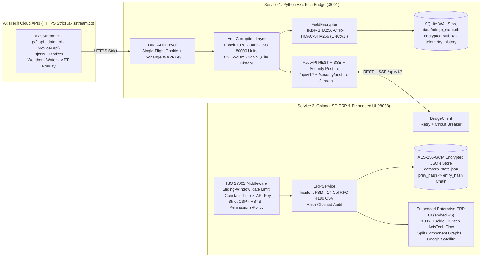

# AxisTech ISO ERP Platform — Unified Engineering Brain ("Bộ não chung")

> **Single Source of Truth** cho toàn bộ hệ sinh thái **AxisTech Module (`AxisStream HQ`) + Golang ISO ERP Platform** (`https://github.com/Phuc0901-pp/2026_axistech_module`).  
> Thiết kế theo bộ tiêu chuẩn **ISO/IEC 42010 · ISO/IEC 27001 · ISO/IEC 25010 · ISO/IEC 29119 · ISA-101**.

---

## 1. Kiến trúc Tổng thể (End-to-End Topology)

---

## 2. Bản đồ Tri thức (Unified Brain Navigation)

| Tài liệu | Phạm vi & Mục đích sử dụng |
|---|---|
| **[01 · System Architecture](docs/brain/01_SYSTEM_ARCHITECTURE.md)** | Kiến trúc Hexagonal (ISO 42010), ranh giới 2 service, luồng đồng bộ gia tăng (incremental cursor), hydrate 24h SQLite, SSE real-time fan-out, Circuit Breaker. |
| **[02 · AxisTech Module (`*.axisstream.co`)](docs/brain/02_MODULE_AXISSTREAM.md)** | Đặc tả tích hợp AxisStream HQ: Auth Cookie + Exchange Token, danh sách thiết bị, `batch -> per-device` fallback, Weather Exchange 17 cột (`tbncorp.weather`), dự báo MET Norway & Jane's Weather, Epoch-1970 `NO_DATA` guard, GeoJSON thửa ruộng. |
| **[03 · Security, Crypto & ISO 27001](docs/brain/03_SECURITY_AND_ENCRYPTION.md)** | Mã hóa lưu trữ `AES-256-GCM` & `HKDF-SHA256-CTR-HMAC-SHA256`, nhật ký Audit liên kết SHA-256 chống sửa, Rate Limiter per-IP, khóa `X-API-Key`, CSP & zero-secret hygiene. |
| **[04 · API & Data Contracts](docs/brain/04_API_AND_DATA_CONTRACTS.md)** | Danh mục đầy đủ endpoint Python Bridge (`/api/v1/*`) & Go ERP (`/api/erp/v1/*`), cấu trúc bảng SQLite, Security Status API, mô hình chuẩn ISO 8601/80000, lỗi RFC 9457. |
| **[05 · Enterprise ERP UX & Real-Time Charts](docs/brain/05_DASHBOARD_UX_AND_CHARTS.md)** | Giao diện ERP nhúng (`embed.FS`), 100% Pure Lucide Icons, luồng 3 bước (`Workspace -> Device -> Split Component Graphs`), bản đồ Google Satellite, Inspector, Quick Search (`Ctrl+K`) & tab `Compliance & Security`. |
| **[06 · Operations Runbook & ADRs](docs/brain/06_OPERATIONS_RUNBOOK_AND_DECISIONS.md)** | Cài đặt, `init.js` (gitignored), `start_live.ps1`, biến môi trường bảo mật, xử lý sự cố Windows (port 8080 Adminer -> 8088) & Architecture Decision Records (`ADR-001`..`ADR-007`). |
| **[ISO/IEC/IEEE 42010](docs/iso_architecture_42010.md)** | Tài liệu mô tả kiến trúc chính thức theo chuẩn ISO 42010:2022. |
| **[ISO/IEC 27001](docs/iso_security_27001.md)** | Ma trận kiểm soát an toàn thông tin & mã hóa toàn hệ thống. |
| **[ISO/IEC/IEEE 29119 Traceability](docs/traceability_matrix_29119.md)** | Ma trận truy vết yêu cầu ↔ test tự động (`UT-001`..`UT-071`, `G-UT-001`..`G-UT-056`). |

---

## 3. Bất biến Hệ thống (Core System Invariants)

1. **AxisTech Single-Module Scope**: Toàn bộ hệ thống chỉ tích hợp duy nhất module **AxisTech (AxisStream HQ)** trên chuẩn dữ liệu ISO 8601 / ISO 80000 / RFC 7946, loại bỏ hoàn toàn các tích hợp ngoại lai.
2. **Defense-in-Depth & At-Rest Encryption**: Dữ liệu hàng đợi Outbox ở SQLite mã hóa bằng `HKDF-SHA256-CTR-HMAC-SHA256` (`ENC:v1:`); trạng thái ERP & Audit Trail lưu trên đĩa bằng `AES-256-GCM`; mỗi `AuditEntry` mang chuỗi băm `prev_hash -> entry_hash` SHA-256.
3. **ISO 27001 Zero-Secret**: Không lưu thông tin đăng nhập, API key, encryption key thật trong mã nguồn, test, `.env.example`, `init.example.js`, hay `.md`. Cấu hình local chỉ nằm ở `init.js` / `.env` (gitignored).
4. **UTC ISO 8601 & Epoch Sentinel Guard**: Mọi mốc thời gian chuẩn hóa về UTC timezone-aware; các mốc rác `1970-01-01` chuyển thành `NO_DATA`.
5. **Pure Lucide & Single-Unit Component Charts**: Giao diện Enterprise ERP chỉ dùng **Lucide Icons**; mọi đại lượng khác đơn vị được tách thành đồ thị thành phần riêng trục Y và nạp sẵn lịch sử 24h từ SQLite.
6. **Legacy XRP2i Isolation**: Không chỉnh sửa script bên ngoài `axisstream_erp_platform/`.
