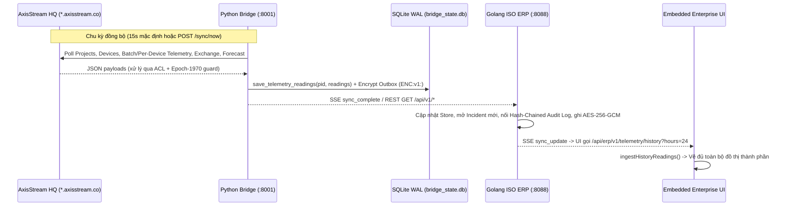

# 01 · System Architecture (ISO/IEC/IEEE 42010)

## 1. Cấu trúc Service & Ranh giới

Dự án tách làm **2 tiến trình độc lập** giao tiếp qua HTTP/REST và SSE nội bộ (`127.0.0.1:8001` ↔ `127.0.0.1:8088`), giúp tách biệt hoàn toàn logic tích hợp AxisTech Cloud (Python) khỏi lõi Enterprise ERP, lớp mã hóa AES-256-GCM và giao diện nhúng zero-dependency (Go).

```text
axisstream_erp_platform/
├── BRAIN.md                          # Trang chủ Bộ não chung
├── init.example.js / init.js         # Cấu hình tài khoản & encryption_key local (init.js bị gitignore)
├── start_live.ps1                    # Launcher zero-secret điều phối cả 2 service
├── data/                             # Lưu trữ bền vững đã mã hóa (gitignored)
│   ├── bridge_state.db               # SQLite WAL: cursors, dedup, outbox mã hóa AEAD, telemetry_history
│   └── erp_state.json                # Atomic AES-256-GCM Encrypted Envelope + SHA-256 Audit Chain
├── docs/
│   ├── brain/                        # 6 module tri thức cốt lõi (01..06)
│   ├── iso_architecture_42010.md
│   ├── iso_security_27001.md
│   └── traceability_matrix_29119.md
└── services/
    ├── axisstream-bridge/            # Python Integration Bridge (Hexagonal + ACL + FieldEncryptor)
    └── erp-platform/                 # Go ISO ERP + AES-256-GCM + Security Middleware + Embedded UI
```

---

## 2. Kiến trúc Hexagonal trong `axisstream-bridge`

```text
services/axisstream-bridge/src/axisstream_bridge/
├── domain/          # Lõi thuần (0 phụ thuộc httpx/fastapi/sqlite3): models.py, normalizers.py, ports.py
├── application/     # Orchestrator & Providers: sync_service.py, live_provider.py, demo_provider.py
├── infrastructure/  # Adapter: http/ (CircuitBreaker, RateLimiter, ResilientHttpClient), auth/, axisstream/, security/ (crypto.py), storage/
└── interfaces/      # Cổng vào: FastAPI REST/SSE/Security Posture (app.py), Security headers (security.py), Webhooks (webhooks.py)
```

Quy tắc kiến trúc được kiểm tra tự động (`UT-012`):
- `domain/` **tuyệt đối không import** `httpx`, `fastapi`, hay `sqlite3`.
- Mọi payload từ `*.axisstream.co` đều đi qua **Anti-Corruption Layer (ACL)** trong `infrastructure/axisstream/` để chuẩn hóa về mô hình miền (`Project`, `Device`, `DeviceTelemetrySnapshot`, `TelemetryReading`, `FieldLocation`, `WeatherExchangeRow`, `ProjectForecastBundle`).

---

## 3. Luồng Đồng bộ Thời gian thực & Hydrate Lịch sử 24h



---

## 4. Cô lập Lỗi & Độ tin cậy (ISO/IEC 25010)

1. **Batch -> Per-Device Fallback**: Khi `/device/{org}/batch` lỗi hoặc trả rỗng, `LiveAxisStreamProvider` tự động gọi từng thiết bị để đảm bảo các cảm biến còn sống không bị mất dữ liệu vì 1 node hỏng.
2. **Resilience trên `ResilientHttpClient`**:
   - **Rate Limiter**: Token Bucket (`10 req/s`, burst `20`).
   - **Circuit Breaker**: `CLOSED -> OPEN -> HALF_OPEN` (ngưỡng 5 lỗi liên tiếp ở cả Bridge và Go `BridgeClient`).
   - **Retry with Exponential Backoff + Jitter**: Chỉ retry `5xx`, `429`, timeout; riêng `401` kích hoạt single-flight `refresh_session()`.
3. **Fail-Safe Startup**: Bridge và Go ERP khởi động fail-open ở vòng sync đầu để `/health/live` và giao diện ERP sẵn sàng ngay lập tức.
