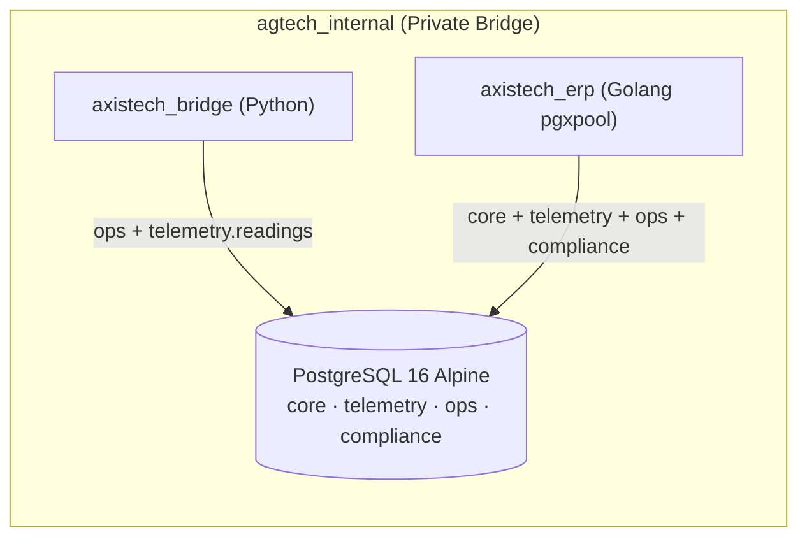

# Kiến trúc Cơ sở dữ liệu PostgreSQL 16 Chuẩn ISO (AxisTech ISO ERP)

## 1. Phạm vi & Tiêu chuẩn áp dụng
- **ISO/IEC/IEEE 42010**: Phân tách rõ 4 schema theo miền trách nhiệm (`core`, `telemetry`, `ops`, `compliance`).
- **ISO/IEC 27001**: Không mở port `5432` ra ngoài mạng Docker; Outbox mã hóa AEAD (`ENC:v1:`); bảng `compliance.audit_log` liên kết băm SHA-256 (`prev_hash -> entry_hash`) và gắn Trigger bất biến chặn mọi lệnh `UPDATE` / `DELETE`; bật **Row-Level Security (RLS)** cô lập theo `project_id`.
- **ISO 8601 & ISO 80000**: Toàn bộ mốc thời gian lưu dạng `timestamptz` UTC, kèm ràng buộc `CHECK (timestamp_utc > '1971-01-01T00:00:00Z'::timestamptz)` chặn dữ liệu Epoch rác; từ điển `telemetry.metric_catalog` lưu đơn vị SI và nhãn tiếng Việt chuẩn hóa.
- **ISO 19115 / RFC 7946**: Tọa độ thiết bị & điểm dự báo bị kiểm tra biên WGS84 (`[-90, 90]`, `[-180, 180]`); GeoJSON thửa ruộng lưu dạng `jsonb`.

---

## 2. Sơ đồ Kiến trúc 4 Schema



---

## 3. Phân vùng Dữ liệu & Tối ưu NAS Synology
- `telemetry.readings` được chia phân vùng theo từng tháng (`PARTITION BY RANGE (timestamp_utc)`) từ `2026-01` đến `2027-12` kèm `readings_default`, tự sinh mới qua hàm `telemetry.ensure_monthly_partition(date)`.
- Kết hợp **B-Tree Composite Index** `(project_id, device_id, metric_key, timestamp_utc DESC)` cho truy vấn đồ thị nhanh và **BRIN Index** `USING brin (timestamp_utc)` siêu nhẹ dung lượng trên ổ cứng NAS.
- Partial Index `WHERE status = 'PENDING'` trên `ops.outbox_events` để quét sự kiện chờ gửi tức thì.

---

## 4. Hướng dẫn Nâng cấp từ Bản cũ trên Synology Container Manager
1. Thêm biến môi trường Postgres vào `.env.prod` trên NAS:
   ```env
   POSTGRES_DB=TbsgAgtech_db
   POSTGRES_USER=agtech_admin
   POSTGRES_PASSWORD=MAT_KHAU_MANH_CUA_BAN
   ```
2. Cập nhật code mới (đã có sẵn `db/migrations/`, `docker-compose.synology.yml` mới), vào **Container Manager -> Project -> `axistech-erp` -> Action -> Build**.
3. Lần đầu khởi động, `axistech_postgres` sẽ tự chạy toàn bộ file `001..004_*.sql` trong `/docker-entrypoint-initdb.d`.
4. Sao lưu định kỳ bằng lệnh:
   ```bash
   docker exec axistech_postgres pg_dump -U agtech_admin -Fc TbsgAgtech_db > backup_$(date +%F).dump
   ```
